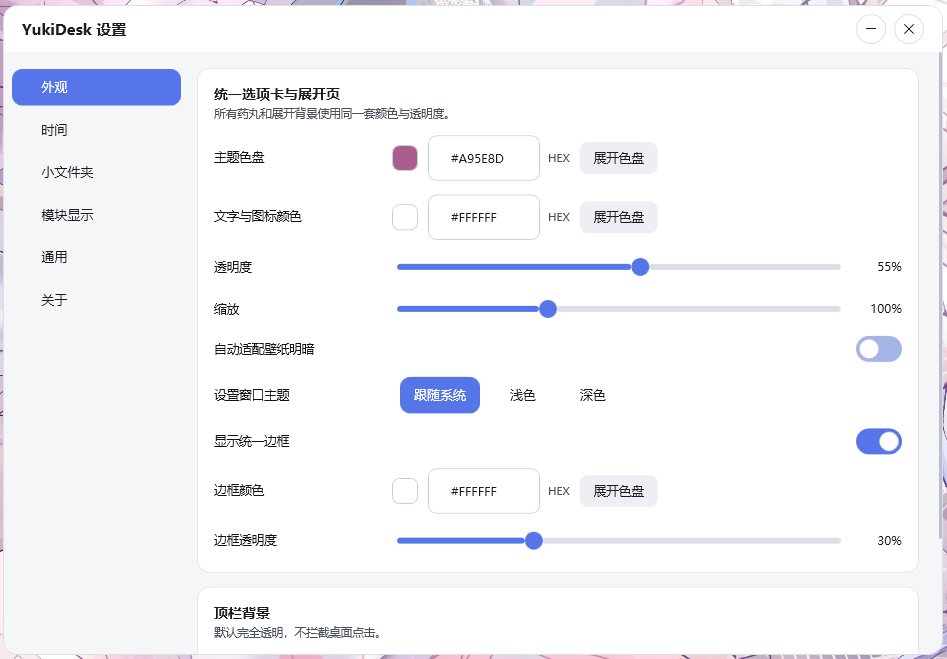
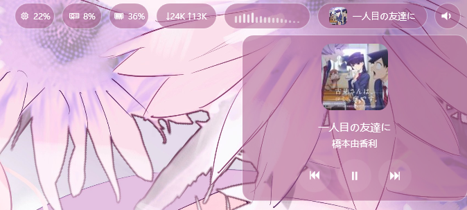

# YukiDesk — Windows 桌面层顶栏

> **项目名称说明**：当前项目正式名称为 **YukiDesk**。`DesktopBar` 是已弃用的旧项目名和历史目录名，不再代表当前产品，也不应在新代码、配置、启动项或文档中继续使用。现有旧目录仅为兼容历史构建路径而保留；程序集、可执行文件、配置目录和用户-facing 文案均以 YukiDesk 为准。

一个常驻**桌面层**的顶栏:所有普通软件窗口都盖在它上面,开机自启秒出。
半透明圆角"药丸"选项卡上集成 **设置、小文件夹、回收站、音乐播放器、音频频谱、音量、时间、性能监测(CPU/GPU/内存/网络)** 等模块,外观与显示项全部可自定义。

技术栈:C# / WPF / .NET 8(选型理由见 `计划书.md`)。

## 预览

顶栏(常驻桌面层,所有普通窗口都盖在它上面):左侧是设置、电源、回收站、小文件夹选项卡,右侧是时间、性能监测胶囊、音频频谱、音乐播放器、音量:


设置窗口(外观、时间、小文件夹、模块显示、通用、关于,全部实时生效):



小文件夹悬停展开:48px 图标面板向下展开,单击文件直接打开,拖文件到选项卡即复制进去:


时间悬停展开:星期、日期、农历(丙午马年 七月十九):


音乐播放器与频谱:播放音乐时自动出现,悬停展开大封面、曲名、歌手与播放控制,左侧频谱随节拍跳动,旁边是 CPU/GPU/内存/网络性能胶囊:



## 构建与运行

```bash
cd YukiDesk
dotnet build -c Release
# 运行
bin/Release/net8.0-windows10.0.19041.0/YukiDesk.exe
```

要求:Windows 10 1809+ / Windows 11,已安装 .NET 8 SDK(构建)或 .NET 8 Desktop Runtime(仅运行)。

支持 **x64 与 ARM64** 两种架构;日常构建无需指定架构,`dotnet build` 产物跟随当前机器。

## 打包安装程序(x64 + ARM64,完整版 + 精简版)

每次打包生成 **4 个**安装程序:x64 / ARM64 两种架构 × **full / slim** 两种运行时类型:

- **full(完整版)**:**自包含**发布,把 .NET 8 桌面运行时等全部依赖一并打进安装程序,用户机器**无需预装任何运行时**;体积较大,推荐大多数用户使用。
- **slim(精简版)**:**框架依赖**发布,不含 .NET 运行时,体积小;要求系统**已安装 [.NET 8 Desktop Runtime](https://dotnet.microsoft.com/download/dotnet/8.0)**,未检测到时安装器会给出提示。

两种安装包均为**每用户**模式(无需管理员权限),程序数据仍保存在 `%AppData%\YukiDesk`。

一次性准备(仅首次):安装 Inno Setup 6,

```bash
winget install JRSoftware.InnoSetup
```

后期每次打包,始终使用同一脚本,不要手动改参数:

```bash
cd YukiDesk
packaging.cmd
```

脚本依次完成:对 `win-x64`、`win-arm64` 分别执行 `dotnet publish -c Release -r <rid> --self-contained true`(full,输出到 `publish\win-<arch>\`)和 `--self-contained false`(slim,输出到 `publish\win-<arch>-slim\`),再对每种组合调用 Inno Setup 按 `installer.iss` 生成安装包。产物:

```
installers\YukiDesk-Setup-x64-full-<版本>.exe    ← x64 设备,自带运行时(含 Windows on ARM 的 x64 模拟)
installers\YukiDesk-Setup-x64-slim-<版本>.exe    ← x64 设备,需已装 .NET 8 桌面运行时
installers\YukiDesk-Setup-arm64-full-<版本>.exe  ← 仅 ARM64 设备,自带运行时
installers\YukiDesk-Setup-arm64-slim-<版本>.exe  ← 仅 ARM64 设备,需已装 .NET 8 桌面运行时
```

- 版本号取自 `DesktopBar.csproj` 的 `<Version>`,自动出现在安装包文件名与"应用和功能"里;发版只需改这一处。
- ARM64 安装包在非 ARM 设备上会拒绝安装;x64 安装包可在 ARM64 设备上以模拟方式运行,但不推荐。
- full 与 slim 使用同一个 AppId,可互相覆盖升级;精简版缺运行时时安装器会警告。
- 安装包自带可选桌面快捷方式;开机自启仍由程序内设置控制(写入 HKCU),安装器不修改启动项。
- 若需单独发布便携版(免安装),执行 `dotnet publish -c Release -r win-x64 --self-contained true -o publish\win-x64` 后直接运行 `publish\win-x64\YukiDesk.exe`。

## 功能说明

| 功能 | 用法 |
|---|---|
| 设置按钮 | 最左圆形选项卡,点击打开设置窗口 |
| 小文件夹 | 悬停选项卡向下展开文件面板(最高半屏,滚轮翻页,少则自动缩小);48px 图标;**单击打开**;把文件/文件夹拖到选项卡或面板上即复制进去 |
| 回收站 | 圆形垃圾桶按钮;**单击展开**(悬停不展开)当前用户回收站内容,单击项目还原到原位置;右键按钮弹出"清空回收站",确认后执行 |
| 音乐播放器 | 播放音乐时自动出现(QQ音乐/网易云/Spotify/浏览器等,基于系统 SMTC);悬停展开大封面、可用时显示进度条、上一首/暂停/下一首 |
| 音频频谱 | 音乐播放器左侧的胶囊频谱:实时采集系统播放声音,16 根对数频段柱随节拍跳动(自动增益,小音量也明显)。可在设置中关闭 |
| 性能监测 | 频谱左侧的四枚胶囊:CPU 占用率、GPU 占用率(多显卡时可在设置中选择监测哪块)、内存占用、网络上下行;悬停显示详情,每项可在设置中单独开关,全部隐藏时不采样 |
| 音量 | 右侧圆形喇叭按钮;展开后显示音量、活动播放设备下拉框;选择设备会同步把 Windows 默认输出切换到该端点,滑块/滚轮/静音仅在用户明确操作后写入该端点 |
| 时间 | 悬停展开星期/日期/农历;折叠态显示项(秒数/日期/星期)与位置(靠右/居中)在设置中调整 |

设置窗口里可调整:

- **外观**:统一选项卡/展开页色盘、文字与图标颜色、透明度、缩放、边框开关与颜色、壁纸明暗自动适配(手动指定颜色后自动适配自动关闭)；设置窗口可单独跟随 Windows 深浅色并提供自定义最小化/最大化/关闭按钮，全部实时生效。
- **小文件夹**:存储路径(默认 `程序目录\MiniFolders`,可改)、新建/重命名/移除。
- **通用**:开机自启、悬停关闭延迟、动画时长、桌面顶部空间预留,以及"模块显示"开关(电源/小文件夹/回收站/音乐播放器/音频频谱/音量,以及性能监测的 CPU/GPU/内存/网络四项,全部即时生效;GPU 占用率可在模块显示里选择监测哪块显卡)。预留开启后通过 Shell AppBar 向 Explorer 注册顶栏占用区域；托盘菜单可打开设置、显示/隐藏顶栏、打开数据目录或退出。
- **关于**:显示当前版本、跳转 GitHub 项目主页;软件更新通过 GitHub Releases 实现,可开关"自动检查更新""自动下载更新",也可手动"检查更新";系统开启代理时自动走系统代理。发现新版本后先下载再询问,确认才安装(安装时会退出 YukiDesk 并启动安装程序,配置与小文件夹不受影响)。

## 使用方法

### 安装

从 [Releases](../../releases) 下载安装包:普通 Intel/AMD 电脑选 `x64`,Windows on ARM 设备选 `arm64`;不确定或想省事选文件名带 `full` 的**完整版**(自带运行时),已装 .NET 8 桌面运行时可选 `slim` **精简版**(体积更小)。双击安装即可,每用户模式,不需要管理员权限。

程序内置更新检查(设置 → 关于):可自动检查/自动下载更新,或手动检查;新版本发布在 GitHub Releases,检测与下载自动使用系统代理。

### 日常操作

- **展开面板**:鼠标悬停在对应选项卡上即可展开（回收站是单击展开）；移开后延迟自动收回，可在设置中调整延迟。
- **小文件夹**:单击文件直接打开；把任意文件/文件夹拖到选项卡或面板上即复制进该文件夹；面板内支持右键菜单（粘贴）。
- **回收站**:单击项目还原到原位置；右键垃圾桶按钮可"清空回收站"（有确认弹窗）。
- **音乐控制**:展开后点击上一首/暂停/下一首；进度条可用时可直接拖动跳转。
- **音量**:滚轮或拖动滑块调节、点击喇叭静音、下拉框切换默认输出设备（仅在你主动操作时写入）。
- **托盘图标**:右键托盘可打开设置、显示/隐藏顶栏、打开数据目录或退出；顶栏被隐藏时从托盘重新显示。
- **开机自启**:在设置 → 通用里开关，写入当前用户注册表启动项，不需要管理员权限。
- **卸载**:系统"设置 → 应用"或开始菜单卸载项即可移除；配置和日志保留在 `%AppData%\YukiDesk`，可手动删除。

## 技术架构

**技术栈**: C# / .NET 8 / WPF(`net8.0-windows10.0.19041.0`,引用 Windows SDK WinRT 投影),单进程 `YukiDesk.exe`,支持 x64 与 ARM64。全部原生 Windows API + 托管代码实现,无第三方运行时依赖。

```
YukiDesk/
├── App.xaml(.cs)        应用入口:全局异常日志、单实例、托盘、设置加载
├── MainWindow.cs        顶栏主窗口:桌面层钉底、AppBar 注册、模块布局
├── Models/Settings.cs   设置模型(可持久化 POCO)
├── Services/
│   ├── SpectrumService  WASAPI 环回采集 + FFT 频谱分析(后台线程)
│   ├── PerfService      CPU/GPU/内存/网络采样(GetSystemTimes、DXGI 显卡枚举、GPU 引擎与网络接口计数器)
│   ├── MediaService     SMTC 全局媒体会话(曲名/封面/进度/控制)
│   ├── VolumeService    MMDevice COM 音量/静音/设备枚举 + WinRT 设备名
│   ├── SettingsService  设置读写(原子写 + 备份 + 损坏隔离)
│   ├── UpdateService    GitHub Releases 更新检查/下载(系统代理、按架构与运行时类型选包)
│   └── AutoStartService 开机自启(当前用户 Run 键)
├── UI/
│   ├── ModuleBase       模块基类:选项卡 + 悬停展开面板框架
│   ├── Modules.cs       小文件夹/回收站/音乐/频谱/音量/性能监测等具体模块
│   ├── SettingsWindow   设置窗口
│   ├── ShellOpen        文件打开(资源管理器集成)
│   └── FlyoutMenu 等    右键菜单/确认框等通用控件
└── Interop/NativeMethods.cs  Win32 P/Invoke(SetWindowPos/AppBar/Shell 图标/注册表等)
```

关键实现机制:

- **桌面层窗口**:WPF 透明分层窗口,`SetWindowPos` 钉在桌面装饰层之上、所有普通窗口之下,并可用 Shell AppBar 占位;每 3 秒保底重钉。
- **频谱**:WASAPI 共享模式环回采集(专用后台线程)→ 2048 点 FFT(汉宁窗)→ 对数频段 → `CompositionTarget.Rendering` 合成帧驱动自绘,UI 线程零阻塞。
- **媒体**:监听 Windows SMTC 全局会话,封面 SHA-256 缓存并在后台线程解码冻结后上屏;播放控制经 SMTC 发回播放器。
- **Shell 集成**:`SHCreateItemFromParsingName`/`SHDefExtractIcon` 在专用 STA 线程队列提取文件图标;文件监视 + 版本号防陈旧;回收站经 `$R/$I` 命名空间枚举与还原。
- **线程模型**:所有 Shell/磁盘/COM/解码重活都在后台线程,UI 线程只做布局与绘制;模块销毁与重建有完整的生命周期守卫。

## 数据位置

- 配置:`%AppData%\YukiDesk\settings.json`
- 日志:`%AppData%\YukiDesk\log.txt`
- 小文件夹默认在 `程序目录\MiniFolders\<名称>\`

## 实现要点

- **桌面层架构**:顶栏本体只有 46px 高的透明"药丸条",通过 `SetWindowPos` 钉在
  "桌面装饰层"(壁纸引擎/桌面整理软件画的图标、挂件)正上方、所有普通软件窗口之下,
  每 3 秒自动保底(钉底前会防御性撤掉外部软件误加的置顶标志)。
  遍历时跳过被 DWM cloak 的窗口,兼容"内容格子"类桌面整理软件;
  `SWP_SHOWWINDOW` 用于强制 DWM 开始合成静默启动的分层窗口。
- **悬停面板是独立的置顶弹出窗口**(`WS_EX_NOACTIVATE|WS_EX_TOOLWINDOW` +
  WPF 分层透明与 `SetWindowRgn` 圆角),不会被其他窗口盖住;
  面板统一使用选项卡的主题色、透明度、边框与缩放,从选项卡边缘生长展开并平滑收回,任意时刻只显示一个。
- **图标提取**:`SHGetFileInfo(ICONLOCATION)` 解析扩展名关联,`SHDefExtractIcon`
  按 UI 缩放请求高分辨率图标,`GetIconInfo` 验证句柄有效后转 `BitmapSource`;无关联时回退
  imageres.dll/shell32.dll 的系统默认文件/文件夹图标。`.lnk` 与 `.url` 只在界面隐藏后缀,
  实际路径和打开行为保持不变。
- **音频频谱**:WASAPI 共享模式环回采集系统播放流(后台线程),2048 点 FFT 加汉宁窗,
  按 40Hz~15kHz 对数划分 22 频段;攻击即时/释放平滑,系统默认输出设备变化或静音时自动重连/回落。
  只读系统音频,不写入音量、不影响播放。
- 若当前聚焦窗口盖住了药丸,顶栏会被一并盖住 —— 这正是"只存在于桌面层"的语义。

## 已知边界

- 顶栏只覆盖主屏。
- 播放设备下拉框枚举活动的 Windows 播放端点并标记/选中当前默认设备(设备名取自 WinRT,端点 ID 与 COM 音量控制统一为 MMDevice 格式)；选择设备会通过 PolicyConfig 把 Windows 默认输出路由(控制台/多媒体/通信)一并切到该端点，Windows 声音设置里会同步显示。
- 回收站模块只显示**当前用户**的回收站项目(其他用户的目录需要管理员权限)；还原使用 $I 元数据里的原始路径,原位置已被占用时自动加 "(1)" 序号后缀。
- 音乐进度条仅在 SMTC 同时提供有效时长和定位能力时显示;不支持定位的播放器会隐藏整条进度条，避免出现不可用的拖动控件。
- 音乐选项卡依赖播放器上报 SMTC;个别播放器关闭该功能时无法检测。
- 个别音源不向系统上报时长,进度时间标签可能显示 0:00。

## 声明

本项目使用 AI 辅助完成。
